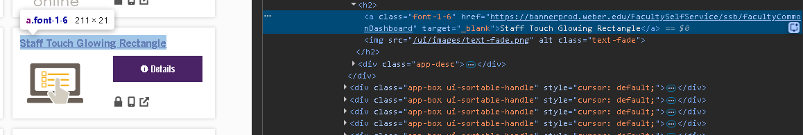
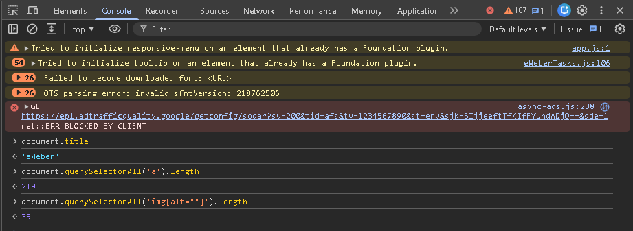
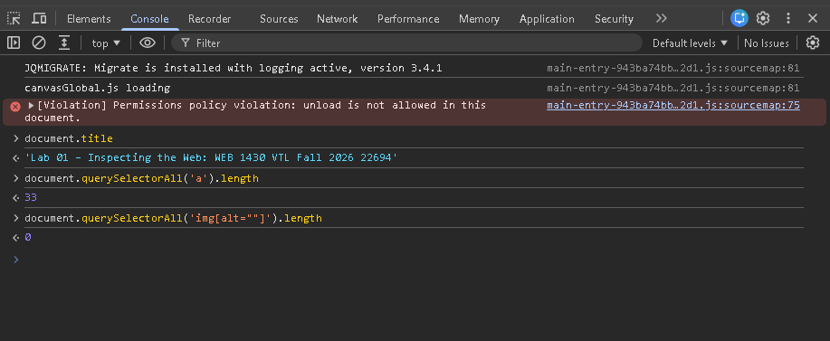

# Lab 01 – Inspection Notes

## Site 1: [URL] https://portalapps.weber.edu/eweber/

### Elements found (5)

(Sorry for not following the formatting on this part. I had it typed out before I saw this page in VSCode.)

| Tag | Semantic? | Purpose |
|-----|-----------|---------|
1. <header>
Semantic tag name. Shows up at the top of a page.

2. <form>
I think this one is a non-semantic tag name, but I'm unsure of its purpose. It seems to hold other content. 

3. <footer>
Semantic tag name. Shows up at the bottom of a page. 

4. <main>
Semantic tag name. Holds the main content/focus of the page.

5. 

Non-semantic tag name. This div holds one of the boxes for the applications that are available on eWeber. 

### Live text edit
[Describe what you changed and paste a screenshot reference here]

I changed the text for faculty dashboard.

### Page structure
- `<main>` present?  - Yes
- `<h1>` present?  - Yes
- `<nav>` present?  - Yes
- Images with `alt` attributes?  - Yes

### Console results

| Expression | Result | What it tells you |
|-----------|--------|------------------|
| `document.title` | 'eWeber' | The website is titled eWeber |
| `document.querySelectorAll('a').length` | 219 | There are 219 'a' elements in the DOM |
| `document.querySelectorAll('img[alt=""]').length` | 35 | There are 35 elements in the document that don't have alternative text for an image.  |

### Network: first request

- URL: https://portalapps.weber.edu/eweber/
- HTTP method: GET
- Status code: 200 OK
- Content-Type: text/html; charset=utf-8
- Total page requests (approx): 130
- Total page weight: 3.8 MB

---

## Site 2: [URL] https://weber.instructure.com/courses/631246/pages/lab01-inspecting-the-web?module_item_id=13566870

### Elements found (5)

| Tag | Semantic? | Purpose |
|-----|-----------|---------|
1. <noscript>
This seems like a semantic tag name. This likely runs if JavaScript is not enabled to notify the user that JavaScript must be enabled to access the website.

2. 

This is a non-semantic tag name. It seems like it's meant to hold a message, but I'm not sure this is meant for the user.

3. 
This is a semantic tag name. It runs a script located at the url that src =, and tells the browser what character set the script uses. (I think)

4. 

Non-semantic tag name. This is a dialog box, and likely only for when a teacher wants to re-lock a module. I'm not sure why it loads into the student view DOM other than that the page creators didn't care to explicitly remove it. 

5. 
Expand the DOM tree and locate five HTML elements on the page. For each element record:

Non-semantic tag name. This one contains the first part of the instructions to do this exercise. I suppose it loads in with JavaScript because it's not part of the base template that it fetches, but I don't know. 

### Console results

| Expression | Result | What it tells you |
|-----------|--------|------------------|
| `document.title` |'Lab 01 – Inspecting the Web: WEB 1430 VTL Fall 2026 22694' | This is the title the page was given in the HTML |
| `document.querySelectorAll('a').length` | 33 | There are 33 'a' elements in the document |
| `document.querySelectorAll('img[alt=""]').length` | 0 | There are 0 elements in the document that don't have alternative text for an image.  |

### Network: first request

- URL: https://weber.instructure.com/courses/631246/pages/lab01-inspecting-the-web?module_item_id=13566870 
- HTTP method: GET
- Status code: 200 OK
- Content-Type: text/html; charset=utf-8

---

## My page (lab00/index.html)

- `document.querySelector('h1').textContent` returned: 'WEB 1430 – Lab 00'
- TypeError produced by: `document.querySelector('p').foo.bar`
- Error message text: VM50:1 Uncaught TypeError: Cannot read properties of undefined (reading 'bar') at <anonymous>:1:32
- What the error message tells you: I'm not sure, but I think there's not anything called bar for it to look at for data.

---

## Reflection

What surprised you? What does DevTools tell you that you couldn't learn by just looking at the page?

[Your answer here — 3–5 sentences]
I was surprised at the depth that DevTools had to offer. They let you see what loads in what order, where those things loaded from,
and information about each thing that loads. They also let you request specifics about that data with the console, though
you do have to understand what you're typing. I was also surprised at just how much more information is in the network tab
than on the page itself. 
