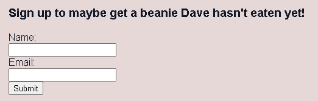

<!-- a place for aggregating important information I've learned>

HTML Form structure
        <section>
            <h3>Sign up to maybe get a beanie Dave hasn't eaten yet!</h3>
            <form>
                <label for="name">Name:</label>  
                <input type="text" id="name" name="name" required>  
                <label for="email">Email:</label>  
                <input type="email" id="email" name="email" required>  
                <button type="submit">Submit</button>
            </form>
        </section>
        