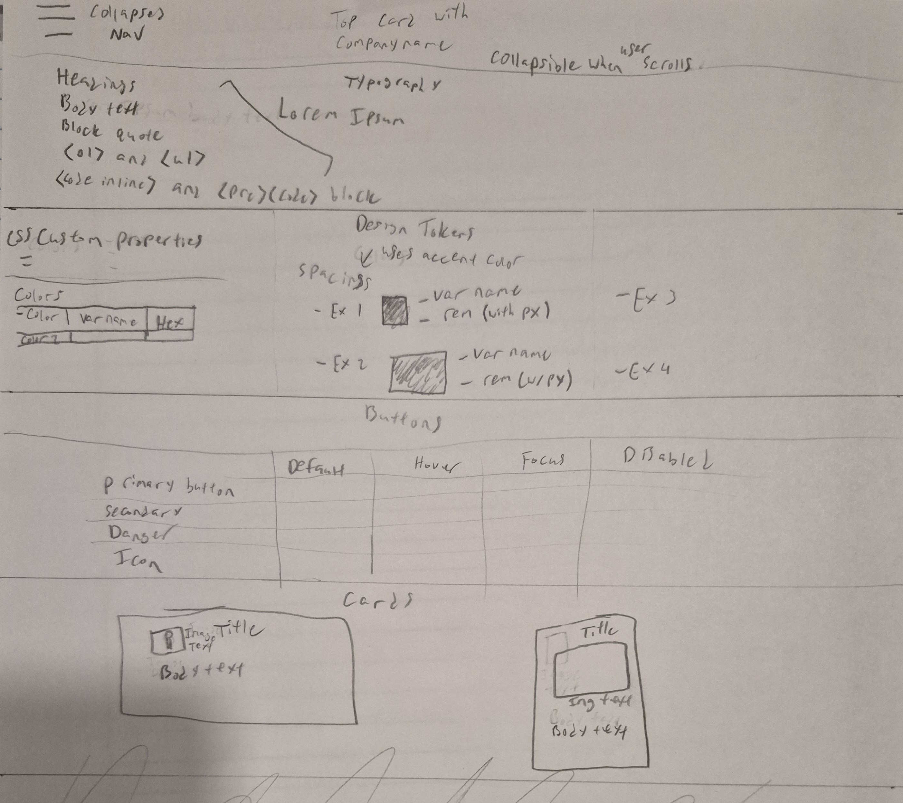

Submit a proposal.md file in projects/project-1/ containing:

## Project context: What is the fictional product or organization? Who is the audience?
We are the Beanie Guys. We sell beanies for guys who like beanies.
(For you lovely gals, see our partners over at Beanie Gals (link))

## Color palette: At minimum four named colors (brand, text, background, accent). 
   Include hex values and confirm contrast ratios using WebAIM Contrast Checker.

    --brand-color: #0036CC;  
    --brand-text-color: #FD6868;
    --text-color: #0000; 
    --background-color: #87bfff; 
    --accent-color: #dd0000; 

    Contrast of brand-text-color on brand-color is 3.06. The brand text will be large text. 
    Contrast of text-color on background-color is 10.92
    Text will not be used on the accent color or outside of these

## Typography plan: Font family choices (Google Fonts or system fonts), scale (at minimum body, small, large, heading sizes in rem).
Font: Museo Moderno

Scale (pretty standard from what I found):
Base: 16 px
 - Body: 1 rem (16 px)
 - Small: 0.75 rem (12 px)
 - Large: 1.125 rem (18 px)
 - Heading 1: 3 rem (48 px)
 - Heading 2: 2 rem (32 px)
 - Heading 3: 1.5 rem (28 px)
 - Heading 4: 1.25 rem (20 px)

HTML Paste:
<link rel="preconnect" href="https://fonts.googleapis.com">
<link rel="preconnect" href="https://fonts.gstatic.com" crossorigin>
<link href="https://fonts.googleapis.com/css2?family=MuseoModerno:ital,wght@0,100..900;1,100..900&display=swap" rel="stylesheet">

CSS paste:
// <weight>: Use a value from 100 to 900
// <uniquifier>: Use a unique and descriptive class name

.museomoderno-<uniquifier> {
  font-family: "MuseoModerno", sans-serif;
  font-optical-sizing: auto;
  font-weight: <weight>;
  font-style: normal;
}

html {
  font-size: 100%; /* Defaults to 16px */
}

.text-small {
  font-size: 0.75rem;
}

body, .text-body {
  font-size: 1rem;
}

.text-large {
  font-size: 1.125rem;
}

h4 {
    font-size: 1.25rem;
}

h3 {
  font-size: 1.5rem;
}

h2 {
  font-size: 2rem;
}

h1 {
  font-size: 3rem;
}

## Component list: The five components you will document (from the required list below).
Design tokens
Typography
Buttons
Cards
Navigation

 ## Rough sketch: A hand-drawn or digital wireframe showing how the style guide page will be organized.
 

## Things I plan to implement:
Option A – Accordion At least four items. One-open-at-a-time behavior. aria-expanded and aria-controls on triggers.
     - Each of the documented components will be in an accordion.

Option B – Tabs At least three tabs. Correct ARIA roles (tablist, tab, tabpanel). Arrow key navigation between tabs.
     - There will be tabs that toggle between boxes that show the different colors specified in root, along with their names. 

## Accessibility plan: For each interactive pattern you plan to implement, answer two questions: 
(a) How will a keyboard-only user operate it? 

Option A, Accordion: The user will be able to tab to an arrow button and press enter or spacebar to expand it.

Option B, Tabs: The user will be able to press the tab key until they hit the tablist, and use their arrow keys to select a tab. This will be an automatic tab interface, meaning they won't have to press enter on each tab to display the content. 

(b) What ARIA attributes will communicate its state to a screen reader? This does not need to be code — a sentence or two per pattern is sufficient.
Proposal does not need to be code — it is a planning document.

Accordion: Each accordion tab will have aria-expanded true/false when they are/are not expanded. The panels will have different ids (eg. panel-1, panel-2), with the aria-controls attribute on the button matching the id of the panel it interacts with. The text's container will also have aria-labeledby to describe which button controls it. 

<h3>
  <button id="accordion-1" class="accordion-button" role="region" aria-expanded="true" aria-controls="panel-1"> Section title </button>
</h3>

  
Text

  

Tabs: The tablist will have a title above it, with each tab having text stating which color attribute it shows. The attributes of the tabs are as shown below. 

I do realize it's a little bit ironic to make tabs that display colors accessible for screen readers. It's mostly for the sake of the assignment. 

<h3>
  <button id="accordion-2" class="accordion-button" role="region" aria-expanded="true" aria-controls="panel-2"> Color tabs </button> 
</h3> 
  
 
    <button id = "tab1" role="tab" aria-selected="true" aria-controls="tabpanel-1" tabindex="0">--color-1</button>
      
--color-1

    <button id = "tab2" role="tab" aria-selected="false" aria-controls="tabpanel-2" tabindex="-1">--color-2</button>
      
--color-2

    <button id = "tab3" role="tab" aria-selected="false" aria-controls="tabpanel-3" tabindex="-1">--color-3</button>
      
--color-3

  

Javascript keydown listener on the tablist to move between tabs by changing the attributes (removing hidden, changing aria-selected and tabindex) and moving the focus
Maybe a css grid would keep the tabs next to each other

There will also be a navigation that is collapsed into a hamburger menu. A keyboard user will be able to tab to it and press enter to open it, and then use arrow keys to reach each part of the navigation, which when interacted with using the enter key will close the nav and put them at the correct section. The aria-expanded attribute will communicate the navigation menu's state to a screen reader.

### Required list (for reference only)
1. Design tokens
A visual reference of every CSS custom property defined in :root:

Colors: Each color displayed as a swatch (a 
 with background-color set to the variable) with its variable name and hex value labeled
Spacing: Each spacing token shown as a colored bar whose width or height equals the token value, labeled with the variable name and computed value
Typography: Each font-size token shown as sample text at that size
2. Typography
Live examples of:

All heading levels (<h1> through <h4>) using your type scale
Body text paragraph with proper line height and measure (45–75 characters per line)
A <blockquote> with attribution
An <ol> and a <ul> in body context
<code> inline and a <pre><code> block

3. Buttons
At minimum four button variants, each shown in default, hover, focus, and disabled states:

Primary button
Secondary button
Destructive/danger button
Icon button (button with an icon and a visible or visually-hidden label)
All buttons must be <button> elements. Hover and focus states must be visible. Disabled buttons must use the disabled attribute (not just a class).
<!-- Kind of funny, looking at the preview of this document, it puts the rest of the document in a button because there's no closing </button> -->

4. Cards
A reusable card component shown in at minimum two configurations:

A basic card (image, title, body text, action)
A horizontal card (image beside text)
Cards must be built with createElement in a renderCard(data) function. Demonstrate rendering at least three cards from a hardcoded data array.

5. Navigation
A responsive <nav> with:

A logo/brand link
At least four nav links
A mobile-friendly state: at narrow viewport, links collapse (can be CSS-only or JavaScript-toggled)
If JavaScript-toggled: aria-expanded on the toggle button, keyboard-accessible open/close

6. Interactive patterns (choose two of three)
Option A – Accordion At least four items. One-open-at-a-time behavior. aria-expanded and aria-controls on triggers.

Option B – Tabs At least three tabs. Correct ARIA roles (tablist, tab, tabpanel). Arrow key navigation between tabs.

Option C – Modal/Dialog A trigger button that opens a dialog overlay. Focus trapped inside the modal while open. Closed by Escape key, a close button, or clicking the backdrop. role="dialog" and aria-labelledby referencing the dialog title. Focus trapping is the one technique in this list the weekly lectures do not cover — read the modal section of Chapter 13: Accessibility Synthesis before choosing this option, or pick Option A or B instead.